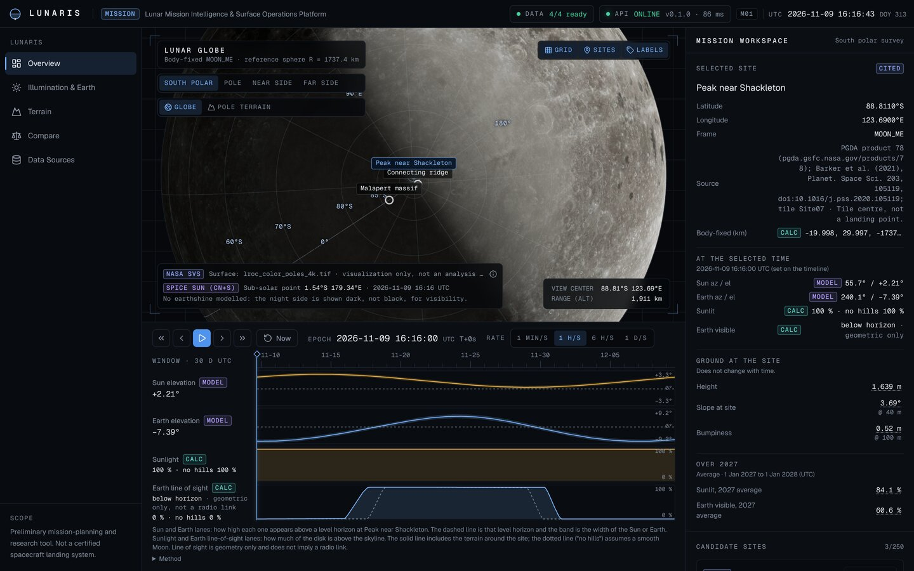

# LUNARIS

**Lunar Mission Intelligence & Surface Operations Platform** — an integrated scientific
and engineering platform for lunar mission planning, built on real NASA datasets, with
an eye toward surface operations.

LUNARIS treats the Moon as an operational environment. Its goal is to answer, with
traceable evidence: *Is this landing site physically suitable? How does its illumination
change over time? When is the Earth geometrically visible? Does terrain obstruct the Sun
or the Earth? How do candidate sites compare, and what are the trade-offs?*

> **Status (9 November 2026): a working research prototype.** Terrain, celestial geometry,
> illumination, Earth line of sight and site comparison are implemented, and every
> computed number opens its data source, method and limitations. The results are checked
> against independent references (below). LUNARIS is a preliminary planning and research
> tool, **not a certified spacecraft landing system**.

**Live demo:** <https://lunaris-demo.onrender.com> (free plan: open it a minute early, the
server sleeps when idle).



*Mission overview: the NASA SVS CGI Moon Kit color map lit by the SPICE Sun at the timeline
epoch (here 9 Nov 2026, near New Moon: the sub-solar point is at 179°E, so the Earth-facing
side is dark), the cited south-pole
sites, and the Sun, Earth, sunlight and line-of-sight lanes for the selected site.*

## What it does

| Page | What you get |
| --- | --- |
| **Overview** `/` | 3D globe in `MOON_ME`, lit by the Moon-centred apparent Sun direction (SPICE, CN+S) at the timeline epoch, with the sub-solar point; the cited south-pole sites (PGDA product 78); a LOLA south-pole terrain scene; timeline lanes for Sun and Earth elevation, terrain-aware sunlight and Earth line of sight |
| **Illumination & Earth** `/illumination` | Sky chart per site: the terrain skyline (1440 azimuths, 200 km, curvature-corrected; truncated azimuths drawn as lower bounds) with the Sun and Earth tracks and their disk widths; sunlit and Earth-visible fractions and windows, with censored runs shown as "≥" |
| **Terrain** `/terrain` | Height, slope at the site, footprint slope (p95) and roughness from the PGDA 20 m DEM, read remotely by HTTP range requests, each with its baseline; optional slope/roughness thresholds, labelled as your assumptions |
| **Compare** `/compare` | Up to 10 sites over 2027, one column per measure. A summary with each measure's direction, the leaders, Pareto dominance and a verdict generated from them, never from hidden weights. Optional mission profiles (power, comms, landing) add a score whose weights are shown as assumptions |
| **Data Sources** `/data` | Every dataset with its provenance, SHA-256 and acquisition status |

Behind it: a FastAPI service (OpenAPI contract, typed errors, evidence on every value) and a
pure scientific core (`lunaris-science`) using NAIF SPICE, NASA LOLA and PGDA data.

**Checked against independent references**
- Sun and Earth directions match JPL Horizons to 0.002″. The sub-solar point matches
  Horizons to 0.005″ under Horizons' own light-time convention.
- Horizon masks match an independent implementation to < 0.0001°.
- Over 2001–2018, illumination at the demo sites is within 0.042 of the published maps of
  Mazarico et al. (2011). The one value above its published range is reported with its causes.

**Tests:** 427 Python tests (plus 4 opt-in tests against live NASA services), 253 web unit
tests and 77 browser end-to-end tests, all in CI.

**How it was built:** a small team working with AI coding assistants (Anthropic's Claude)
under human direction and review. Results are trusted because they are tested and checked
against the references above, not because of who or what wrote the code.

## Repository layout

```
apps/
  api/                FastAPI application (lunaris-api)
  web/                Next.js mission-control client (@lunaris/web)
packages/
  science/            lunaris-science — pure scientific core (no I/O)
  data/               lunaris-data — manifests, acquisition, integrity, preprocessing, CLI
  shared-types/       @lunaris/shared-types — OpenAPI-generated + draft contract types
data/                 local data store (git-ignored contents): raw/ kernels/ processed/ state/ fixtures/
tests/                science/ data/ api/ integration/ (incl. e2e/ Playwright specs)
docs/                 ARCHITECTURE · SCIENCE · DATA_SOURCES · API · ROADMAP
scripts/dev.mjs       runs API + web together
```

## Prerequisites

| Tool | Version | Notes |
| --- | --- | --- |
| Node.js | ≥ 20.9 (tested 22) | npm ≥ 10 |
| Python | ≥ 3.11 (tested 3.11 in CI, 3.12, 3.13) | |
| [uv](https://docs.astral.sh/uv/) | ≥ 0.5 (tested 0.11) | `curl -LsSf https://astral.sh/uv/install.sh \| sh` |

GDAL (via rasterio) and CSPICE (via SpiceyPy) install as binary wheels; no system
libraries are needed.

## Setup

```bash
npm install          # JavaScript workspaces (web + shared-types)
uv sync              # Python workspace into .venv (uses uv.lock)
cp .env.example .env # optional; defaults work for local development
```

## Run

```bash
npm run dev          # API on http://localhost:8000 and web on http://localhost:3000
```

Or separately: `npm run dev:api` and `npm run dev:web`. API docs: <http://localhost:8000/docs>.

Production build of the web client: `npm run build && npm run start:web`.

### Acquire NASA data (requires access to NASA archive hosts)

```bash
uv run lunaris-data list                                # registry + local status
uv run lunaris-data acquire naif-generic-kernels-lunar  # ~45 MB SPICE kernels
uv run lunaris-data acquire lola-ldem-75s-240m          # ~29 MB LOLA DEM
uv run lunaris-data acquire nasa-svs-cgi-moon-kit       # ~13 MB color map (visualization)
uv run lunaris-data build-web-texture                   # globe switches to the NASA texture
uv run lunaris-data verify lola-ldem-75s-240m           # re-hash against the record
```

### Docker

```bash
docker compose up --build    # API :8000, web :3000; ./data is bind-mounted
```

## Two-minute demo

Live at <https://lunaris-demo.onrender.com>. Open it a minute early: free instances sleep
after about 15 minutes idle, and the page says so while the server wakes.

1. **Globe.** The NASA SVS color map lit by the SPICE Sun at the timeline epoch; the HUD
   shows "SPICE Sun (CN+S)" and the sub-solar point. Press play or scrub the timeline and the
   terminator moves. Click a cited site: it shows its source (PGDA product 78, Barker et al.
   2021) and the note "tile centre, not a landing point".
2. **Pole Terrain.** A 250 km square of LOLA heights at true vertical scale, lit by the same
   Sun. Rendered shadows are labelled illustrative; the numbers come from the API.
3. **Timeline lanes.** Sun and Earth elevation over 30 days, terrain sunlight, and Earth line
   of sight (geometric only, not a radio link).
4. **Illumination & Earth.** The sky chart for a site: skyline, Sun and Earth tracks with their
   disk widths, and the sunlit and Earth-visible windows.
5. **Terrain.** Pick a site and press Analyse: height, slope and roughness with their
   baselines. Enter a maximum slope to see hazard flags, labelled as your assumption.
6. **Compare.** The demo trio over 2027. The summary answers "which site is best?" honestly:
   no single site wins every measure; Peak near Shackleton leads on slope, sunlight and Earth
   visibility but is the roughest; Malapert massif is the smoothest. Pick a mission profile
   (power, comms, landing) to see a weighted ordering with its weights shown. Under landing,
   Malapert comes first. Click any number for its method, sources (with SHA-256) and limits.
7. **Where the numbers come from:** see "Checked against independent references" above.
   Shackleton's floor comes out at exactly 0 % sunlit.

## Hosted demo (Render)

Two Docker web services, both built from this repository's root:

| Service | Dockerfile | Environment (also passed as build args) |
|---|---|---|
| API | `apps/api/Dockerfile` | `LUNARIS_BAKE_DATASETS=naif-generic-kernels-lunar lola-ldem-75s-240m`, `LUNARIS_PREWARM_DEMO=1`, `LUNARIS_CORS_ORIGINS=<web URL>` |
| Web | `apps/web/Dockerfile` | `NEXT_PUBLIC_LUNARIS_API_URL=<API URL>` |

- Without a persistent disk, the API image bakes the checksum-verified kernels and the LOLA
  DEM into `/data`, then warms the cited demo trio's horizon masks and PGDA windows.
- The web image builds the NASA SVS globe texture in its own stage
  (`LUNARIS_WEB_TEXTURE=0` skips it, and the globe then shows its labelled placeholder).
- On a free plan, sites registered at runtime are lost when the instance restarts. The image
  starts with the demo trio already registered.

## Test and check

```bash
npm run check          # lint + format + typecheck + contract drift + all unit/integration tests
uv run pytest          # Python: science, data, API, live uvicorn integration
npm run test:web       # web unit tests (Vitest)
npx playwright install chromium --with-deps   # once, from apps/web
npm run test:e2e       # browser end-to-end against a real API + web server
npm run contracts:generate   # after changing API schemas
```

## Configuration

| Variable | Default | Purpose |
| --- | --- | --- |
| `LUNARIS_ENVIRONMENT` | `development` | `development` · `test` · `production` |
| `LUNARIS_LOG_LEVEL` | `INFO` | API log level |
| `LUNARIS_CORS_ORIGINS` | `http://localhost:3000,http://127.0.0.1:3000` | Explicit browser origins (no wildcards) |
| `LUNARIS_DATA_DIR` | `./data` | Local data store root |
| `LUNARIS_DATABASE_URL` | SQLite in `<data>/state/` | SQLAlchemy URL |
| `LUNARIS_DOCS_ENABLED` | `true` | Serve `/docs`, `/redoc`, `/openapi.json` |
| `NEXT_PUBLIC_LUNARIS_API_URL` | `http://localhost:8000` | API base URL for the browser (inlined at build time) |

No secrets are required. Never put secrets in `NEXT_PUBLIC_*` variables.

## Known warnings

- Without an acquired texture, the browser console shows one **404 for
  `/textures/moon/manifest.json`** — that is the placeholder fallback working as designed.
- **`THREE.Clock: This module has been deprecated`** is emitted inside
  `@react-three/fiber` 9.8 with three.js r187; it is harmless and will disappear with an
  upstream update.
- `npm audit` reports moderate advisories in the **ESLint toolchain** (`minimatch`), a
  development-only dependency that is not shipped to browsers.

## Documentation

- [Architecture](docs/ARCHITECTURE.md) — packages, dependency rules, contracts, decisions
- [Science](docs/SCIENCE.md) — conventions, implemented calculations, planned methods, validation
- [Data sources](docs/DATA_SOURCES.md) — datasets, provenance rules, verification
- [API](docs/API.md) — endpoints and conventions
- [Roadmap](docs/ROADMAP.md) — milestones, including the future LUNARIS FIELD research track
- [Decisions](docs/DECISIONS.md) — accepted architectural decision records

## Data credits

NASA PDS Geosciences Node (LRO LOLA), NASA NAIF (SPICE), NASA Scientific Visualization
Studio (CGI Moon Kit), JPL Solar System Dynamics (Horizons). See
[docs/DATA_SOURCES.md](docs/DATA_SOURCES.md) for full citations.
